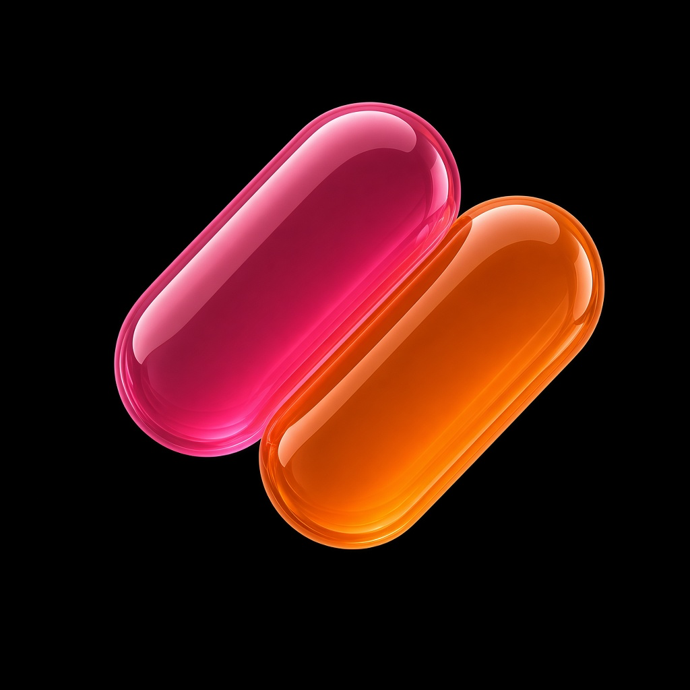

<p align="center">
  
</p>

<h1 align="center">Press Start</h1>

<p align="center">
  <strong>Native iPhone shelf</strong> for the Game Boy, GBA, NES, SNES, and Mega Drive games you own.<br>
  Full-speed play · Works with gamepads · Saves stay on your phone
</p>

<p align="center">
  <a href="https://nikolaikushner.github.io/PressStart/">Landing page</a>
  ·
  <a href="landing/STORE.md">App Store prep</a>
  ·
  <a href="landing/privacy.html">Privacy</a>
  ·
  <a href="LICENSE">AGPL-3.0</a>
  ·
  <a href="SOURCE.md">Corresponding source</a>
  ·
  Paid App Store ($1.49)
</p>

---

| | |
| --- | --- |
| **Brand** | Press Start |
| **Bundle ID** | `com.nikolaikushner.pressstart` |
| **Subtitle** | `Retro Emulator · GB GBA NES SNES` |
| **Price** | **$1.49** on the App Store |
| **Systems** | GB · GBC · GBA · NES · SNES · Mega Drive |
| **UI** | SwiftUI shelf (not Delta branding) |
| **Engine** | [DeltaCore](https://github.com/rileytestut/DeltaCore) + system cores |
| **License** | [AGPL-3.0](LICENSE) |

This public repository is the **corresponding source** for App Store builds ([SOURCE.md](SOURCE.md)). The Safari / EmulatorJS player is retired; GitHub Pages is marketing only.

## Build

1. Xcode 16+ and [XcodeGen](https://github.com/yonaskolb/XcodeGen) (`brew install xcodegen`).
2. Bootstrap DeltaCore (and optionally the five system cores):

```bash
./PressStart/scripts/bootstrap-cores.sh
```

3. Generate and open the project:

```bash
cd PressStart
xcodegen generate
open PressStart.xcodeproj
```

4. Select your Apple Developer team, then run on an iPhone or simulator.
5. Link `GBCDeltaCore`, `GBADeltaCore`, `NESDeltaCore`, `SNESDeltaCore`, and `GPGXDeltaCore` from `Vendor/` in Xcode for real gameplay. Without them the shelf, import, skins, and gamepad routing still build; play shows a core-missing message until the frameworks are linked.

`CoreRegistry` registers cores automatically when those modules are present (`canImport`).

## What’s in the app

- Dark shelf grouped by console, search, frosted **Games | Add** dock  
- ROM import via Files with byte-based console detection  
- Pocket / Advance on-screen shells (no console trademarks)  
- Soft-pad hits + Apple `GameController` support for Bluetooth / USB gamepads  
- On-disk SRAM and save states under Documents  
- Cover snapshots after play  
- In-app Licenses with GitHub source link (AGPL)

## License & legal

Press Start is **AGPL-3.0**. You may sell copies (App Store **$1.49**); you must keep corresponding source available. See [NOTICE](NOTICE) and [SOURCE.md](SOURCE.md).

Do not distribute commercial ROMs. Users bring their own legally obtained backups — the app does not download games.
