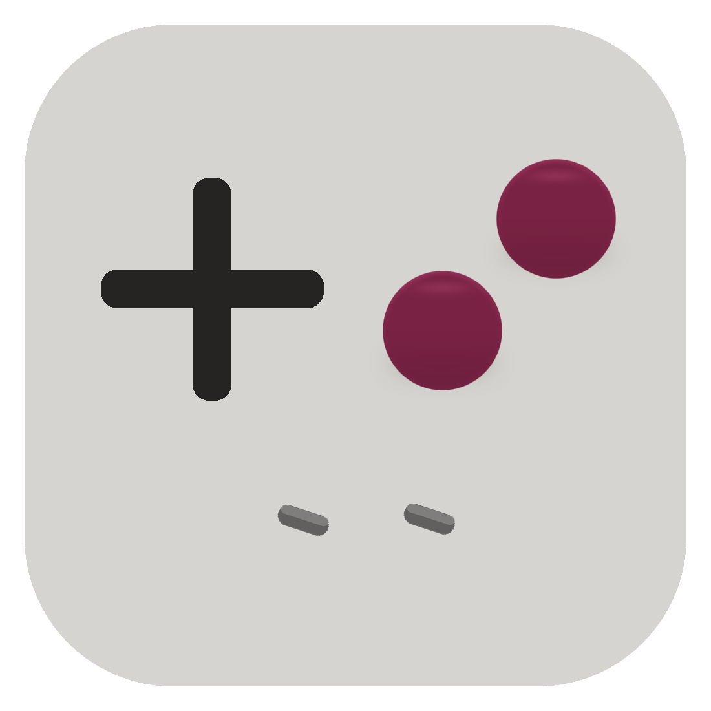

<p align="center">
  
</p>

<h1 align="center">Press Start</h1>

<p align="center">
  <strong>Native iPhone shelf</strong> for the Game Boy, GBA, NES, SNES, and Mega Drive games you own.<br>
  Full-speed play · Works with gamepads · Saves stay on your phone
</p>

<p align="center">
  
  
  
  
  
  
</p>

<p align="center">
  <a href="https://nikolaikushner.github.io/PressStart/">Landing</a>
  ·
  <a href="landing/STORE.md">App Store prep</a>
  ·
  <a href="landing/privacy.html">Privacy</a>
  ·
  <a href="SOURCE.md">Source</a>
  ·
  <a href="LICENSE">AGPL-3.0</a>
</p>

---

| | |
| --- | --- |
| **Brand** | Press Start |
| **Bundle ID** | `com.nikolaikushner.pressstart` |
| **Subtitle** | `Retro Emulator · GB GBA NES SNES` |
| **Systems** | GB · GBC · GBA · NES · SNES · Mega Drive |
| **UI** | SwiftUI shelf (not Delta branding) |
| **Engine** | [DeltaCore](https://github.com/rileytestut/DeltaCore) + system cores |
| **License** | [AGPL-3.0](LICENSE) |

This public repository is the **corresponding source** for App Store builds ([SOURCE.md](SOURCE.md)). The Safari / EmulatorJS player is retired; GitHub Pages is marketing only.

## Build

1. Xcode 16+ and [XcodeGen](https://github.com/yonaskolb/XcodeGen) (`brew install xcodegen`).
2. Bootstrap DeltaCore and the five system cores (they are gitignored):

```bash
./PressStart/scripts/bootstrap-cores.sh
```

3. Generate and open the project. `project.yml` links `DeltaCore`, `ZIPFoundation`, and the five core frameworks:

```bash
cd PressStart
xcodegen generate
open PressStart.xcodeproj
```

4. Signing uses the Apple team signed into Xcode (`S37Z4QU5FT`, Mikalai Kushner). Run on an iPhone or simulator.

5. App icon and the in-app shells share the GameSir palette: light-grey shell, near-black D-pad, deep-magenta face buttons, dark-grey Select/Start. Open `PressStart/AppIcon.icon` in **Icon Composer** (Xcode 26+) — only the face buttons are Liquid Glass; the D-pad and pills stay matte. Rebuild the icon with `PressStart/scripts/generate-app-icon.py` and the shells with `PressStart/scripts/generate-skins.py`.

`CoreRegistry` registers a core when its framework is linked (`canImport`). Game Boy, GBA, NES, SNES, and Mega Drive then play through DeltaCore’s Metal renderer. The shelf draws its own shell; Delta’s on-screen controller stays hidden.

## What’s in the app

- Dark shelf grouped by console, search, frosted **Games | Add** dock  
- ROM import via Files with byte-based console detection  
- Pocket / Advance on-screen shells (no console trademarks)  
- Soft-pad hits + Apple `GameController` support for Bluetooth / USB gamepads  
- On-disk SRAM and save states under Documents  
- Cover snapshots after play  
- In-app Licenses with GitHub source link (AGPL)

## License & legal

Press Start is **AGPL-3.0**. You may sell copies; you must keep corresponding source available. See [NOTICE](NOTICE) and [SOURCE.md](SOURCE.md).

Do not distribute commercial ROMs. Users bring their own legally obtained backups — the app does not download games.
